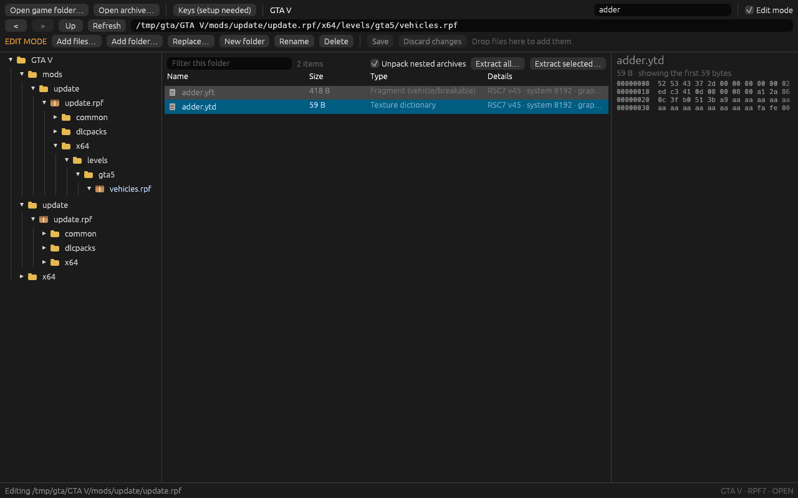
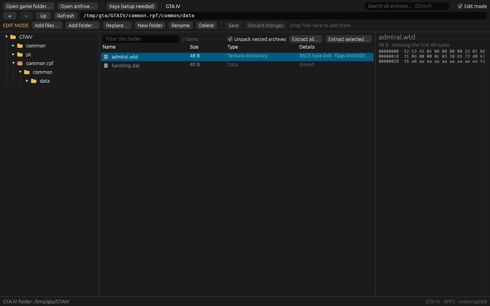
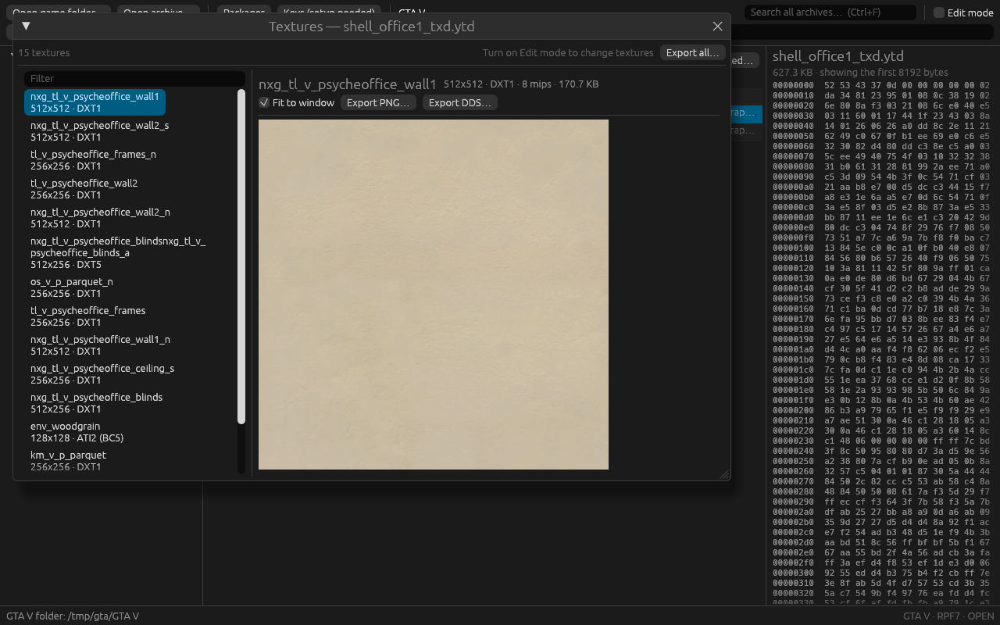
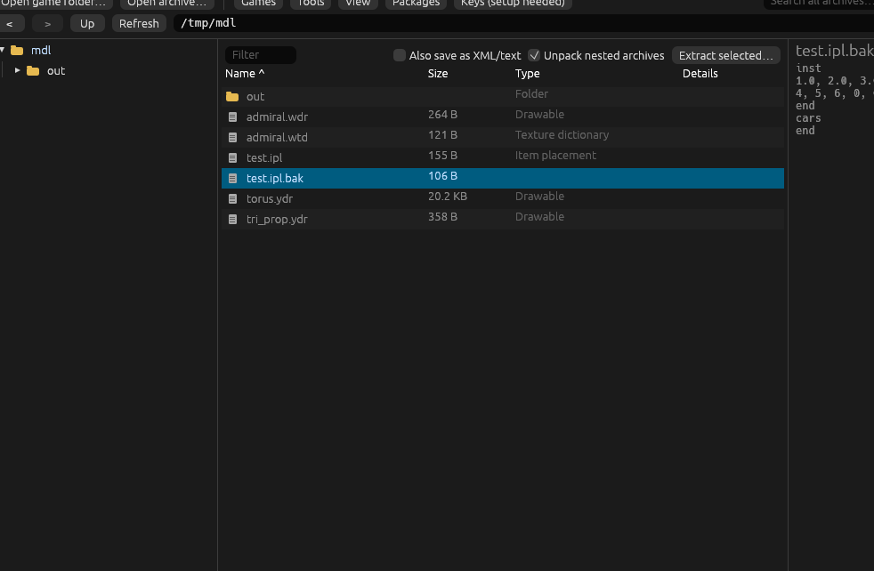
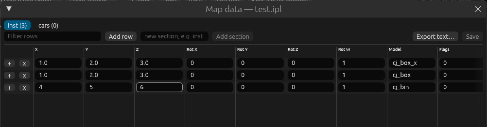
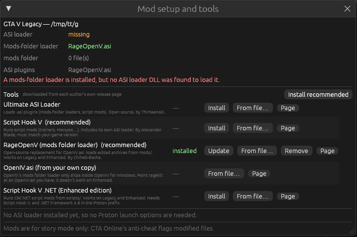
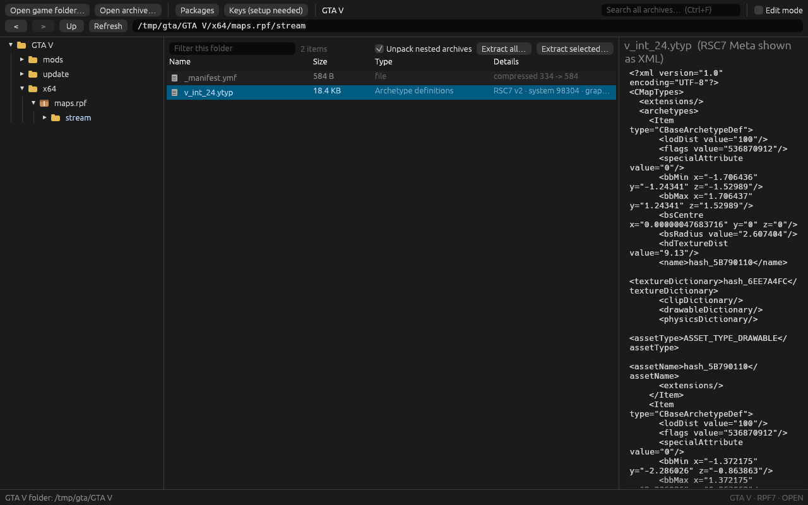

# ragekit

A native Linux modding tool for **GTA V**, **GTA IV / Episodes from Liberty City** and **Max Payne 3** (OpenIV's three games), with read-only support for **Red Dead Redemption** RPF6 archives. It's in the spirit of OpenIV. It is one program: run `ragekit` to open the browser, or give it a command to use it from the terminal. It's written in Rust and does not use Wine.



## What it does

| | GTA V | GTA IV / EFLC | Max Payne 3 |
|---|---|---|---|
| Archives | `.rpf` (RPF7): none, OPEN, AES and NG encryption; nested archives (DLC packs) | `.rpf` (RPF2), audio `.rpf` (RPF3, read-only), `.img` (IMG3), plain and encrypted | `.rpf` (RPF4), plain and encrypted |
| Browse, search, preview, extract | ✓ | ✓ | ✓ |
| Add, replace, rename, delete, new folder | ✓ (written as OpenIV-style OPEN archives) | ✓ (written unencrypted, which the game accepts) | ✓ (written unencrypted) |
| Resources | RSC7 (`.ytd`, `.ydr`, `.yft`, `.ymap`…) | RSC5 (`.wtd`, `.wdr`, `.wft`…) | RSC6, kept as is |
| Textures | `.ytd`: view, export PNG/DDS; replace/add/remove (Legacy; Enhanced is view/export) | `.wtd` and textures inside models: view, export, replace | — |
| 3D models | `.ydr`, `.ydd`, `.yft`: textured viewer, export OBJ; `.ydr` ⇄ CodeWalker XML | `.wdr`, `.wdd`, `.wft`: textured viewer, export OBJ | — |
| Map data | — | `.ide` / `.ipl` (text): table editor | — |
| Scripts (`.ysc`) | header, native calls and strings | — | — |
| Text tables (`.gxt2`) | view, export/import as text | — | — |
| Add-on vehicles | folder of `.yft`/`.ytd`/`.meta` → installable DLC pack or `.oiv` | — | — |
| Binary metadata | PSO (`.ymt`, `.ymf`), RSC7 Meta (`.ytyp`, `.ymap`, ped `.ymt`), RBF: view, export and edit as XML | — | — |
| `.oiv` packages | ✓ install into `mods/` (or the game), uninstall | ✓ install in place with backups, uninstall | — (the format doesn't cover it) |

**Red Dead Redemption** `.rpf` (RPF6, from the Xbox 360 / PS3 releases) opens read-only. Names show as hashes unless the archive carries its debug name table.

Exported files use the same form as OpenIV, CodeWalker and SparkIV, so files move freely between them.

### The browser

- **Game folder view.** Opening any path inside a GTA V, GTA IV or EFLC install finds the game folder. ragekit remembers it for the next launch.
- **One tree for everything.** The left-hand tree shows real folders, archives and nested archives together. Double-click to go in. Use Back, Forward and Up, or type a path into the address bar, including paths inside archives.
- **Preview.** Text files (`.meta`, `.xml`, `.dat`, `.ide`, `.ipl`, …) open as text. Everything else shows a hex view, and resources also show their header details.
- **Search.** Ctrl+F searches every archive in the game, including nested ones. Click a result to jump to it.
- **Extract.** Extract the selection or a whole folder, optionally unpacking nested archives.
- **Edit mode**, as in OpenIV:
  - Add files or folders (or drop them on the window), replace, rename, delete and create folders.
  - Changes stay pending until you **Save** (Ctrl+S). Saving keeps a `.bak` of the original.
  - For GTA V, ragekit offers to copy the archive into `mods/` before you edit it, so the original game files stay untouched.



### Textures

Double-click a `.ytd` (GTA V) or `.wtd` (GTA IV) to open the texture viewer. It lists every texture with its size, format and mip count, and shows a preview on a transparency checkerboard. You can export one texture or all of them as PNG or DDS. In edit mode, **Replace…** takes a PNG, JPEG, TGA, BMP or DDS and keeps the texture's name and format, building mipmaps automatically. **Add…** and **Remove** work too.



GTA IV dictionaries can't change shape, because the game reads them in place: **Replace…** converts your image to the original texture's size, format and mip count (a PNG of a different size is resized), and adding, removing or renaming textures is turned off.

### 3D models

Double-click a model to open the viewer. It handles GTA V `.ydr`, `.ydd` and `.yft`, and GTA IV `.wdr`, `.wdd` and `.wft`. Drag to rotate, right-drag to pan, scroll to zoom and double-click to reset. You can turn on a wireframe, turn textures off, and hide single meshes.

- **Textures:** textures embedded in the model are used, along with a texture dictionary of the same name in the same folder (`adder.yft` uses `adder.ytd`). **Load textures…** adds any other `.ytd` or `.wtd`.
- **Export OBJ…** writes a Wavefront OBJ with its `.mtl` and the textures as PNG, ready for Blender.
- **Export XML…** (`.ydr`) writes CodeWalker XML, with embedded textures as `.dds` files beside it. `ragekit model x.ydr --from-xml x.ydr.xml` builds a `.ydr` back from that XML.

The viewer is a small software renderer, so it needs no GPU setup. It shows the highest level of detail. GTA V fragments place their wheels and parts; GTA IV fragments show only the main body for now.



### Map data (GTA IV)

Double-click a text `.ide` (item definitions) or `.ipl` (placements) to edit it as a table, one tab per section (`objs`, `inst`, `cars`…). Common columns have names. You can filter rows, edit cells, duplicate, add or delete rows, and add sections. Lines you don't touch are written back exactly as they were, comments included. Loose files are saved with a `.bak`. Files inside archives need edit mode, like any other change.



### Scripts (GTA V)

Selecting a `.ysc` shows its name, code size, parameter, static and global counts, every native it calls (as the hashes the game resolves) and its string table. `ragekit script` prints the same and can save the raw bytecode. Scripts are replaced like any other file. Decompiling bytecode isn't included.

### Finding your games, installing modding tools and checking the setup

**Games** lists GTA V and GTA IV installs found in Steam libraries (native, Flatpak and Snap, including extra library folders), in Rockstar or Epic launchers inside Proton prefixes, and in Heroic and Lutris. The first launch opens one automatically.

**Games → Mod setup and tools** installs the usual prerequisites and checks the result. **Install recommended** sets a game up in one click:

| Tool | Games | Comes from |
|---|---|---|
| Script Hook V (with its ASI loader) | GTA V Legacy and Enhanced | Alexander Blade's site, dev-c.com (newest version) |
| RageOpenV, the open-source replacement for OpenIV.asi (loads `mods/`) | GTA V Legacy and Enhanced | its GitHub releases |
| Ultimate ASI Loader (`dinput8.dll`, or `xinput1_4.dll` on Enhanced, 32-bit for GTA IV) | GTA V, GTA IV | its GitHub releases |
| Script Hook V .NET (Enhanced edition, works on both) | GTA V | its GitHub releases |
| FusionFix | GTA IV / EFLC | its GitHub releases |
| OpenIV.asi | GTA V Legacy | only from your own copy (it ships inside OpenIV for Windows) |

Nothing is bundled with ragekit; each tool is downloaded from its author when you install it. If a site refuses the download, **From file…** installs a zip, `.asi` or `.dll` you downloaded yourself. Installing a tool that replaces another (Script Hook V's loader over the Ultimate ASI Loader, say) removes the other first. Every install is recorded in `<game>/.ragekit/tools/` with backups of anything it overwrote, so **Remove** puts the folder back as it was.

Under Proton, Wine uses its own built-in `dinput8.dll` unless told otherwise. After an install, ragekit adds the needed `WINEDLLOVERRIDES="dinput8=n,b" %command%` to the game's **Steam launch options**, keeping any options you already had. Steam must be closed for this, because it rewrites its settings when it exits. The original is kept as `localconfig.vdf.ragekit.bak`. If Steam is running, or you use Lutris or Heroic, the window shows the line to paste yourself.

The same window flags setups that won't work, such as files in `mods/` with no loader, or OpenIV.asi on Enhanced.



### Add-on vehicle packs

**Tools → Add-on vehicle pack** takes a folder holding a car's `.yft`/`.ytd` files and its `.meta` files and builds a complete DLC:
- `setup2.xml` and `content.xml`, with each data file registered by type
- the model files in `x64/vehicles.rpf`

It can install the pack, which adds it to `mods/` and registers it in `dlclist.xml`, through the package installer, so it can be uninstalled. It can also save the pack as a `.oiv` to share.

### Other conveniences

- Click column headers to sort. Arrow keys move the selection, Enter opens, Ctrl+A selects all, F2 renames, F5 refreshes, Backspace goes up and Ctrl+F searches.
- The right-click menu has **Open with default app**, **Open as XML/text in editor**, **Show in file manager**, **Export as XML/text** and **Replace from XML/text**.
- The status bar shows how many items are selected and their total size.
- **Also save as XML/text** when extracting puts a readable `.xml` or `.txt` next to each binary metadata or `.gxt2` file.
- **View** has a dark or light theme and four text sizes. **Games → Recent** remembers the last 10 folders and archives.
- **Tools → Hash calculator** gives the joaat hashes of model and label names.

### Packages (.oiv)

Open an `.oiv` with **Packages → Install package**, drop it on the window, or run `ragekit gui mod.oiv`.


1. You see the package's name, author, icon and description, in its own colors, as in OpenIV.
2. **Check & install** runs the whole package in memory against your game and lists every step, plus the files it will change. **Nothing on disk changes yet.**
3. **Install** writes the files. If any write fails, everything is rolled back.
4. **Packages → Installed packages** lists what you've installed. **Uninstall** puts every changed file back exactly as it was. If a later install changed the same files, ragekit asks you to undo that one first.

Supported `assembly.xml` commands:
- `archive`, including nested archives and `createIfNotExist`
- `add`, both inside archives and as loose files
- `delete`
- `text`: `insert` before/after a line, `replace`, `add` and `delete`, with the `Equal`, `Mask`, `StartWith`, `EndWith` and `Contains` conditions
- `xml`: `add` with `First`/`Last`/`Before`/`After`, `replace` and `remove`
- `pso`, and `xml` on binary files: the file is converted to XML, edited and converted back to its own format
- `defragmentation`, accepted but not needed

Running the same package twice doesn't duplicate XML entries or text lines. Packages marked `<gameversion>` are checked against Legacy or Enhanced.

### Binary metadata

PSO, RSC7 Meta and RBF files show as XML in the preview. In the right-click menu, **Export as XML** saves that XML, and in edit mode **Replace from XML** converts an XML file back into the same binary format. Names come from a built-in table of tens of thousands of game names; hashes with no known name show as `hash_XXXXXXXX`.

Before ragekit changes a binary file, it converts the untouched original to XML and back and checks that nothing changed. If that check fails, ragekit refuses to edit the file rather than risk damaging it. Real `.ymf`, `.ytyp` and `.ymap` files from public mods pass the check, including Enhanced-edition files.



## Build

```sh
cargo build --release            # binary: target/release/ragekit
install -Dm755 target/release/ragekit ~/.local/bin/ragekit
install -Dm644 packaging/ragekit.desktop ~/.local/share/applications/ragekit.desktop
```

The window runs on X11 or Wayland through OpenGL. File pickers use the desktop portal (`xdg-desktop-portal`, present on GNOME, KDE and most desktops). Without a portal you can still type paths into the address bar.

## Keys (one-time setup)

Rockstar's decryption keys can't be distributed, so ragekit takes them from **your own copies** of the games. Use **Keys** in the toolbar, or the CLI. Keys are stored in `~/.config/ragekit/keys` and checked against known SHA-1 hashes before they're saved.

```sh
# GTA IV / EFLC key, and the first GTA V key, read from the executables:
ragekit keys extract --exe ~/.steam/steam/steamapps/common/"Grand Theft Auto IV/GTAIV" \
                     --exe ~/.steam/steam/steamapps/common/"Grand Theft Auto V"

# GTA V NG keys (most GTA V archives). Pick one:
sudo ragekit --keys ~/.config/ragekit/keys keys extract --running   # game running under Proton
ragekit keys extract --magic /path/to/CodeWalker/magic.dat           # CodeWalker's key bundle
ragekit keys extract --from-dir /path/to/Keys                        # CodeWalker/GTAUtil keys folder

# Max Payne 3: the key is found by trying candidates from the exe against one of
# the game's own encrypted archives (nothing is shipped, not even a hash):
ragekit keys extract --exe ~/.steam/steam/steamapps/common/"Max Payne 3/Max Payne 3"
# If the exe is packed, start the game and scan it instead:
sudo ragekit --keys ~/.config/ragekit/keys keys extract --running
# The same works for an encrypted RDR archive:  --exe <dump>/default.xex --archive <some>.rpf

ragekit keys status
```

## Command line

```sh
G=~/.steam/steam/steamapps/common/"Grand Theft Auto V"

ragekit                                   # open the browser (last game folder)
ragekit gui "$G"                          # open the browser at a folder or archive
ragekit info  "$G/x64a.rpf"
ragekit ls    "$G/update/update.rpf" common/data -l
ragekit ls    "$G/update/x64/dlcpacks/mpbiker/dlc.rpf" -r -n      # -n: into nested rpfs
ragekit find  "$G" 'adder*'
ragekit cat   "$G/update/update.rpf" common/data/handling.meta > handling.meta
ragekit xml   "$G/x64/levels/gta5/props.rpf" some/file.ytyp > file.xml   # binary metadata as XML
ragekit xml   my.ymap > my.xml && ragekit xml my.ymap --import my.xml    # edit a loose file
ragekit extract "$G/x64e.rpf" levels/gta5/vehicles.rpf -o out -x  # -x: unpack nested rpfs

ragekit add "$G/mods/update/update.rpf" handling.meta --to common/data
ragekit rm  "$G/mods/update/update.rpf" common/data/some.meta
ragekit mv  "$G/mods/update/update.rpf" common/data/a.meta b.meta
ragekit pack my_dlc/ -o dlc.rpf                         # GTA V (folders named *.rpf nest)

# Textures, models, text tables, tools
ragekit tex   "$G/x64/vehicles.rpf" adder.ytd                     # list textures (also GTA IV .wtd)
ragekit model "$G/x64/vehicles.rpf" adder.yft --obj out/adder.obj  # info + OBJ/MTL/PNG export
ragekit model prop.ydr --xml prop.ydr.xml                          # CodeWalker XML (+ .dds)
ragekit model prop.ydr --from-xml prop.ydr.xml                     # and back
ragekit script "$G/update/update.rpf" x64/levels/gta5/script/script_rel.rpf/main.ysc
ragekit tex   my.ytd --export out/ [--dds]                           # export all
ragekit tex   my.ytd --replace adder_badges=new.png --add decal.png  # edit (keeps a .bak)
ragekit xml   "$G/update/update.rpf" x64/data/lang/americandlc.rpf/global.gxt2 > text.txt
ragekit extract "$G/update/update.rpf" common/data -o out --convert  # + .xml/.txt copies
ragekit games                                                        # find installs
ragekit setup --game "$G"                                            # mod setup check
ragekit tools list    --game "$G"                                    # modding tools for this game
ragekit tools install --game "$G"                                    # recommended set + Steam launch options
ragekit tools install scripthookv --game "$G" --from ~/Downloads/ScriptHookV_3889.0_1158.13.zip
ragekit tools remove  rageopenv --game "$G"
ragekit addon ~/cars/mycar --install "$G"                            # or --oiv mycar.oiv
ragekit hash adder zentorno

# Packages
ragekit oiv info  mod.oiv
ragekit oiv install mod.oiv --game "$G" --dry-run    # show what would happen
ragekit oiv install mod.oiv --game "$G"              # GTA V: into mods/ (add --no-mods for the game itself)
ragekit oiv list --game "$G"
ragekit oiv uninstall <id> --game "$G"

# GTA IV
IV=~/.steam/steam/steamapps/common/"Grand Theft Auto IV/GTAIV"
ragekit ls  "$IV/pc/models/cdimages/vehicles.img" -l
ragekit add "$IV/pc/models/cdimages/vehicles.img" admiral.wft admiral.wtd
ragekit pack my_files/ -o common.rpf --format iv        # or: -o x.img for IMG3

# Max Payne 3
MP3=~/.steam/steam/steamapps/common/"Max Payne 3/Max Payne 3"
ragekit ls "$MP3/data.rpf" -l
ragekit pack my_files/ -o mymod.rpf --format mp3
```

## Layout

| Crate | What |
|---|---|
| `crates/ragekit-core` | Formats, crypto, keys, the editable `Tree` model, search |
| `crates/ragekit` | The `ragekit` program: browser (`gui.rs`) and CLI (`cli.rs`) |

## Roadmap

1. ~~GTA V archive core + CLI~~
2. ~~GTA IV archives, file browser, single tool~~
3. ~~`.oiv` package installer~~
4. ~~Binary metadata (PSO, RSC7 Meta, RBF) as XML~~
5. ~~Texture viewer and replacer for GTA V `.ytd` and GTA IV `.wtd`~~ (Enhanced writing to do)
6. ~~GTA IV `.ide`/`.ipl` editor, GTA V `.ysc` viewer~~ (binary GTA IV `.wpl` placements to do)
7. ~~Model viewer (`.ydr`, `.ydd`, `.yft`, `.wdr`, `.wdd`, `.wft`), OBJ export~~ (Enhanced models, GTA IV fragment parts, Max Payne 3 models to do)
8. Audio (`.awc`), Max Payne 3 textures and models, NG re-encryption for GTA V

## Known limits

- **Not yet tested on real game files.** Every format is tested on synthetic archives built to the documented layouts. Please report any archive that fails to open.
- Edited GTA V archives are saved as OPEN archives, so the game needs a mods-folder loader (OpenIV.asi, OpenRPF or RageOpenV).
- RPF3 (GTA IV audio) is read-only and shows names as hashes.
- GTA IV models and `.wtd` textures, and GTA V `.ysc` headers, follow the documented layouts and are tested on files built to them, not yet on real game files. GTA V models are read by `rage-formats`, which is tested against real files.
- Enhanced (gen9) GTA V models don't open in the viewer yet.
- Max Payne 3 and RDR support follows the documented archive layouts and hasn't been checked against the PC game files yet. Whether Max Payne 3 loads an unencrypted edited archive in place of an encrypted one is untested.
- RDR RPF6 is read-only and console-only. Compressed files in Xbox 360 dumps use LZX (XCompress), which ragekit can't decompress yet, so those files fail to extract.
- RDR 2 (RPF8) isn't supported: its archives use Rockstar's TFIT cipher, whose keys can't be taken from the game the same way.
- Script Hook V only works with the game version it was built for; after a game update, install it again once its author has released a new version.
- Script Hook V .NET needs .NET Framework 4.8 inside the game's Proton prefix (for example `protontricks 271590 dotnet48`).
- Use mods in single-player only.

## Credits

PSO and RSC7 Meta reading and writing, GTA V model parsing and CodeWalker XML conversion use the public-domain [`rage-formats`](https://github.com/VIRUXE/rage-formats) crate; its one-triangle `.ydr` XML is used as a test fixture. RBF follows CodeWalker's Rbf.cs (MIT). The `.oiv` command semantics follow the open-source CodeWalker OIV Package Installer. The RPF4/RPF6 layouts follow RPFTool (twisted89) and the public-domain `rpf-archive` crate (VIRUXE). The format details come from the GTAMods wiki, CodeWalker (crypto routines ported from GTACrypto/GTAKeys, MIT, © 2015 Neodymium) and SparkIV's documentation of the GTA IV formats. `key_hashes.rs` holds only SHA-1 hashes of key material, never the keys themselves.

Not affiliated with Rockstar Games, Take-Two or the OpenIV team.
