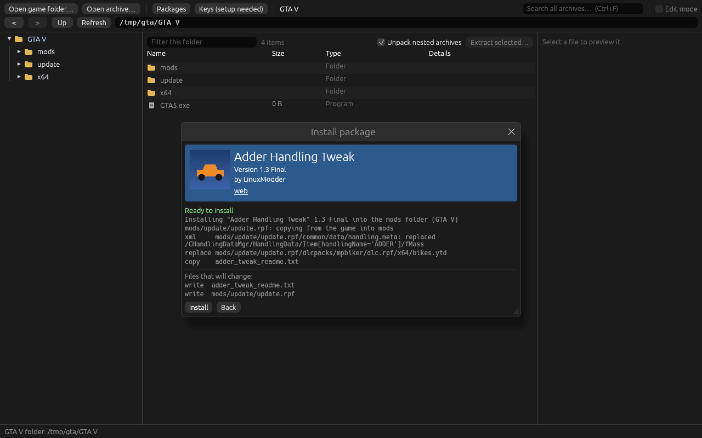

# ragekit

A native Linux modding tool for **GTA V** and **GTA IV / Episodes from Liberty City**, in the spirit of OpenIV. It is one program: run `ragekit` to open the browser, or give it a command to use it from the terminal. It's written in Rust and does not use Wine.


## What it does

| | GTA V | GTA IV / EFLC |
|---|---|---|
| Archives | `.rpf` (RPF7): none, OPEN, AES and NG encryption; nested archives (DLC packs) | `.rpf` (RPF2), audio `.rpf` (RPF3, read-only), `.img` (IMG3), plain and encrypted |
| Browse, search, preview, extract | ✓ | ✓ |
| Add, replace, rename, delete, new folder | ✓ (written as OpenIV-style OPEN archives) | ✓ (written unencrypted, which the game accepts) |
| Resources | RSC7 (`.ytd`, `.ydr`, `.yft`, `.ymap`…) | RSC5 (`.wtd`, `.wdr`, `.wft`…) |
| Binary metadata | PSO (`.ymt`, `.ymf`), RSC7 Meta (`.ytyp`, `.ymap`, ped `.ymt`), RBF: view, export and edit as XML | — |
| `.oiv` packages | ✓ install into `mods/` (or the game), uninstall | ✓ install in place with backups, uninstall |

Exported files use the same form as OpenIV, CodeWalker and SparkIV, so files move freely between them.

### The browser

- **Game folder view.** Opening any path inside a GTA V, GTA IV or EFLC install finds the game folder. ragekit remembers it for the next launch.
- **One tree for everything.** The left-hand tree shows real folders, archives and nested archives together. Double-click to go in. Use Back, Forward and Up, or type a path into the address bar, including paths inside archives.
- **Preview.** Text files (`.meta`, `.xml`, `.dat`, `.ide`, `.ipl`, …) open as text. Everything else shows a hex view, and resources also show their header details.
- **Search.** Ctrl+F searches every archive in the game, including nested ones. Click a result to jump to it.
- **Extract.** Extract the selection or a whole folder, optionally unpacking nested archives.
- **Edit mode**, as in OpenIV:
  - Add files or folders (or drop them on the window), replace, rename, delete and create folders.
  - Changes stay pending until you **Save** (Ctrl+S). Saving keeps a `.bak` of the original.
  - For GTA V, ragekit offers to copy the archive into `mods/` before you edit it, so the original game files stay untouched.


### Packages (.oiv)

Open an `.oiv` with **Packages → Install package**, drop it on the window, or run `ragekit gui mod.oiv`.



1. You see the package's name, author, icon and description, in its own colors, as in OpenIV.
2. **Check & install** runs the whole package in memory against your game and lists every step, plus the files it will change. **Nothing on disk changes yet.**
3. **Install** writes the files. If any write fails, everything is rolled back.
4. **Packages → Installed packages** lists what you've installed. **Uninstall** puts every changed file back exactly as it was. If a later install changed the same files, ragekit asks you to undo that one first.

Supported `assembly.xml` commands:
- `archive`, including nested archives and `createIfNotExist`
- `add`, both inside archives and as loose files
- `delete`
- `text`: `insert` before/after a line, `replace`, `add` and `delete`, with the `Equal`, `Mask`, `StartWith`, `EndWith` and `Contains` conditions
- `xml`: `add` with `First`/`Last`/`Before`/`After`, `replace` and `remove`
- `pso`, and `xml` on binary files: the file is converted to XML, edited and converted back to its own format
- `defragmentation`, accepted but not needed

Running the same package twice doesn't duplicate XML entries or text lines. Packages marked `<gameversion>` are checked against Legacy or Enhanced.

### Binary metadata

PSO, RSC7 Meta and RBF files show as XML in the preview. In the right-click menu, **Export as XML** saves that XML, and in edit mode **Replace from XML** converts an XML file back into the same binary format. Names come from a built-in table of tens of thousands of game names; hashes with no known name show as `hash_XXXXXXXX`.

Before ragekit changes a binary file, it converts the untouched original to XML and back and checks that nothing changed. If that check fails, ragekit refuses to edit the file rather than risk damaging it. Real `.ymf`, `.ytyp` and `.ymap` files from public mods pass the check, including Enhanced-edition files.


## Build

```sh
cargo build --release            # binary: target/release/ragekit
install -Dm755 target/release/ragekit ~/.local/bin/ragekit
install -Dm644 packaging/ragekit.desktop ~/.local/share/applications/ragekit.desktop
```

The window runs on X11 or Wayland through OpenGL. File pickers use the desktop portal (`xdg-desktop-portal`, present on GNOME, KDE and most desktops). Without a portal you can still type paths into the address bar.

## Keys (one-time setup)

Rockstar's decryption keys can't be distributed, so ragekit takes them from **your own copies** of the games. Use **Keys** in the toolbar, or the CLI. Keys are stored in `~/.config/ragekit/keys` and checked against known SHA-1 hashes before they're saved.

```sh
# GTA IV / EFLC key, and the first GTA V key, read from the executables:
ragekit keys extract --exe ~/.steam/steam/steamapps/common/"Grand Theft Auto IV/GTAIV" \
                     --exe ~/.steam/steam/steamapps/common/"Grand Theft Auto V"

# GTA V NG keys (most GTA V archives). Pick one:
sudo ragekit --keys ~/.config/ragekit/keys keys extract --running   # game running under Proton
ragekit keys extract --magic /path/to/CodeWalker/magic.dat           # CodeWalker's key bundle
ragekit keys extract --from-dir /path/to/Keys                        # CodeWalker/GTAUtil keys folder

ragekit keys status
```

## Command line

```sh
G=~/.steam/steam/steamapps/common/"Grand Theft Auto V"

ragekit                                   # open the browser (last game folder)
ragekit gui "$G"                          # open the browser at a folder or archive
ragekit info  "$G/x64a.rpf"
ragekit ls    "$G/update/update.rpf" common/data -l
ragekit ls    "$G/update/x64/dlcpacks/mpbiker/dlc.rpf" -r -n      # -n: into nested rpfs
ragekit find  "$G" 'adder*'
ragekit cat   "$G/update/update.rpf" common/data/handling.meta > handling.meta
ragekit xml   "$G/x64/levels/gta5/props.rpf" some/file.ytyp > file.xml   # binary metadata as XML
ragekit xml   my.ymap > my.xml && ragekit xml my.ymap --import my.xml    # edit a loose file
ragekit extract "$G/x64e.rpf" levels/gta5/vehicles.rpf -o out -x  # -x: unpack nested rpfs

ragekit add "$G/mods/update/update.rpf" handling.meta --to common/data
ragekit rm  "$G/mods/update/update.rpf" common/data/some.meta
ragekit mv  "$G/mods/update/update.rpf" common/data/a.meta b.meta
ragekit pack my_dlc/ -o dlc.rpf                         # GTA V (folders named *.rpf nest)

# Packages
ragekit oiv info  mod.oiv
ragekit oiv install mod.oiv --game "$G" --dry-run    # show what would happen
ragekit oiv install mod.oiv --game "$G"              # GTA V: into mods/ (add --no-mods for the game itself)
ragekit oiv list --game "$G"
ragekit oiv uninstall <id> --game "$G"

# GTA IV
IV=~/.steam/steam/steamapps/common/"Grand Theft Auto IV/GTAIV"
ragekit ls  "$IV/pc/models/cdimages/vehicles.img" -l
ragekit add "$IV/pc/models/cdimages/vehicles.img" admiral.wft admiral.wtd
ragekit pack my_files/ -o common.rpf --format iv        # or: -o x.img for IMG3
```

## Layout

| Crate | What |
|---|---|
| `crates/ragekit-core` | Formats, crypto, keys, the editable `Tree` model, search |
| `crates/ragekit` | The `ragekit` program: browser (`gui.rs`) and CLI (`cli.rs`) |

## Roadmap

1. ~~GTA V archive core + CLI~~
2. ~~GTA IV archives, file browser, single tool~~
3. ~~`.oiv` package installer~~
4. ~~Binary metadata (PSO, RSC7 Meta, RBF) as XML~~
5. Texture viewer and replacer (`.ytd`/`.wtd` ↔ DDS/PNG)
5b. GTA IV `.ide`/`.ipl` editors
6. Model viewer (`.ydr`, `.yft`, `.wdr`, `.wft`)
7. NG re-encryption and `.ysc` import for GTA V

## Known limits

- **Not yet tested on real game files.** Every format is tested on synthetic archives built to the documented layouts. Please report any archive that fails to open.
- Edited GTA V archives are saved as OPEN archives, so the game needs a mods-folder loader (OpenIV.asi, OpenRPF or RageOpenV).
- RPF3 (GTA IV audio) is read-only and shows names as hashes.
- Use mods in single-player only.

## Credits

PSO and RSC7 Meta reading and writing use the public-domain [`rage-formats`](https://github.com/VIRUXE/rage-formats) crate. RBF follows CodeWalker's Rbf.cs (MIT). The `.oiv` command semantics follow the open-source CodeWalker OIV Package Installer. The format details come from the GTAMods wiki, CodeWalker (crypto routines ported from GTACrypto/GTAKeys, MIT, © 2015 Neodymium) and SparkIV's documentation of the GTA IV formats. `key_hashes.rs` holds only SHA-1 hashes of key material, never the keys themselves.

Not affiliated with Rockstar Games, Take-Two or the OpenIV team.
